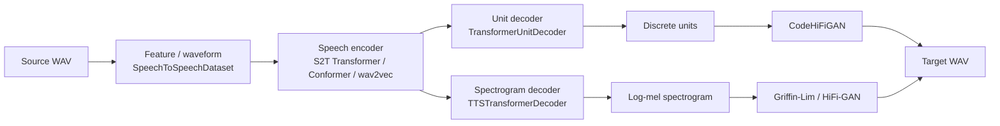
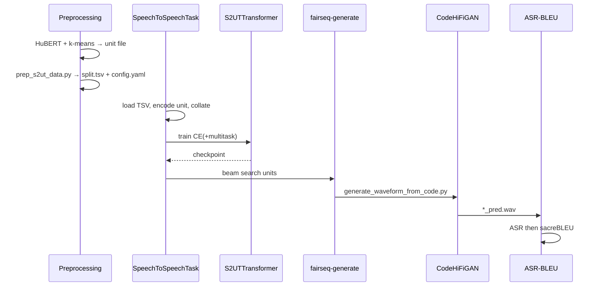

# Flow Speech-to-Speech Translation (S2ST)

Tài liệu này giải thích **luồng xử lý end-to-end** của example `fairseq/examples/speech_to_speech`: từ dữ liệu thô đến waveform ngôn ngữ đích, và ánh xạ từng bước sang code trong repo.

Mục tiêu của S2ST: **speech nguồn → speech đích** (dịch nói), không bắt buộc đi qua text trung gian.

---

## 1. Bức tranh tổng thể

Có hai nhánh chính, cùng task `speech_to_speech`, khác nhau ở **biểu diễn target**:

| Nhánh | Target | Criterion | Architecture điển hình | Vocoder lúc infer |
| --- | --- | --- | --- | --- |
| **S2UT** (speech-to-unit) | Discrete unit (HuBERT + k-means) | `speech_to_unit` | `s2ut_transformer` / Conformer / Unity | Code-HiFi-GAN |
| **S2SPECT** (speech-to-spectrogram) | Mel spectrogram | `speech_to_spectrogram` | `s2spect_transformer` (Translatotron-style) | Griffin-Lim hoặc HiFi-GAN |



Pipeline vận hành theo 5 giai đoạn:

1. **Chuẩn bị target** (unit hoặc spectrogram)
2. **Format manifest** (`*.tsv` + `config.yaml`)
3. **Train** (`fairseq-train` + task `speech_to_speech`)
4. **Generate** (unit hoặc spectrogram → waveform)
5. **Đánh giá** (ASR-BLEU, optional MCD)

---

## 2. Bản đồ thư mục example

```
fairseq/examples/speech_to_speech/
├── README.md                          # Ba paper / ba setup
├── docs/
│   ├── direct_s2st_discrete_units.md  # S2UT + S2SPECT gốc (Lee et al. 2021)
│   ├── textless_s2st_real_data.md     # mHuBERT, speech normalizer, vocoder đa ngôn ngữ
│   ├── enhanced_direct_s2st_discrete_units.md  # wav2vec + unit mBART finetune
│   └── data_augmentation.md           # noise / concat augment trên SpeechToTextDataset
├── preprocessing/
│   ├── prep_s2ut_data.py              # Manifest S2UT
│   ├── prep_s2spect_data.py           # Manifest S2SPECT + zip log-mel
│   ├── prep_sn_data.py                # Input speech normalizer
│   ├── prep_sn_output_data.py         # Post-process output normalizer
│   └── data_utils.py                  # config.yaml, reduce unit, load unit file
├── generate_waveform_from_code.py     # Unit → WAV (CodeHiFiGAN)
├── unity/                             # Sequence generator 2-pass (MT rồi T2U)
├── asr_bleu/                          # ASR rồi sacreBLEU
└── benchmarking/                      # Runtime / memory / FLOPS
```

Phần **task / model / dataset / criterion** không nằm trong example mà nằm ở core fairseq:

| Thành phần | File |
| --- | --- |
| Task | `fairseq/tasks/speech_to_speech.py` (`SpeechToSpeechTask`) |
| Dataset | `fairseq/data/audio/speech_to_speech_dataset.py` |
| S2UT / S2SPECT Transformer | `fairseq/models/speech_to_speech/s2s_transformer.py` |
| Conformer / Unity | `s2s_conformer.py`, `s2s_conformer_unity.py`, `s2s_conformer_translatotron2.py` |
| Loss | `fairseq/criterions/speech_to_speech_criterion.py` |
| Vocoder | `fairseq/models/text_to_speech/vocoder.py` (`CodeHiFiGANVocoder`) |

`examples/speech_to_speech/__init__.py` chỉ import `unity` để đăng ký generator 2 decoder.

---

## 3. Giai đoạn 1 — Chuẩn bị dữ liệu nguồn và đích

### 3.1 Layout audio

Hai thư mục song song:

```
$SRC_AUDIO/{split}/{sample_id}.wav
$TGT_AUDIO/{split}/{sample_id}.wav
```

- S2UT: target nên **16 kHz** (HuBERT).
- S2SPECT: target khuyến nghị **22 050 Hz**.

Nếu chỉ có ST (speech→text), có thể synthesize target speech bằng TTS (`examples/speech_synthesis`) rồi mới làm S2ST.

### 3.2 Target cho S2UT: discrete unit

Luồng:

```
Target WAV
  → HuBERT (layer 6 / 11)
  → k-means cluster
  → chuỗi unit: "3 3 3 17 17 8 ..."
  → file ${TGT_AUDIO}/${SPLIT}.txt  (format: sample_id|u1 u2 ...)
```

Paper gốc dùng **HuBERT Base layer 6, 100 unit**.  
Textless / Enhanced dùng **mHuBERT layer 11, 1000 unit**.

**Reduced vs stacked:**

- `--reduce-unit` trong `prep_s2ut_data.py` gộp unit trùng liền kề: `1 1 1 2 2` → `1 2`. Vocoder infer phải bật `--dur-prediction` để khôi phục duration.
- **Stacked** (`--n-frames-per-step r`, không reduce): decoder mỗi bước dự đoán `r` unit, pack thành một id (`pack_units` trong dataset và `StackUnitSequenceGenerator`). Infer stacked chỉ hỗ trợ greedy (`beam=1`).

### 3.3 Target cho S2SPECT: log-mel

`prep_s2spect_data.py`:

1. Load target WAV, resample (mặc định 22050), optional normalize volume.
2. Extract log-mel 80 dim → `.npy`.
3. Zip thành `logmelspec80.zip`.
4. Manifest trỏ vào offset trong zip.

---

## 4. Giai đoạn 2 — Format manifest

### 4.1 S2UT (`prep_s2ut_data.py`)

Với mỗi split:

1. Đọc `${target_dir}/{split}.txt` qua `load_units`.
2. Duyệt `${source_dir}/{split}/*.wav`.
3. Ghi TSV cột: `id`, `src_audio`, `src_n_frames`, `tgt_audio`, `tgt_n_frames`.
   - `src_n_frames` ≈ số frame 10 ms (`n_samples // 160` với 16 kHz).
   - **`tgt_audio` ở đây không phải path WAV** mà là **chuỗi unit** (`"3 17 8 ..."`).
4. Sinh `config.yaml`: SpecAugment `lb`, `utterance_cmvn`, optional vocoder `code_hifigan`.

### 4.2 S2SPECT (`prep_s2spect_data.py`)

Cùng schema TSV, nhưng `tgt_audio` là **path trong zip** (log-mel). Config thêm tham số spectrogram (`n_mels`, `hop_length`, …) và `delta_deltas`.

### 4.3 Multitask phụ (optional)

Mỗi auxiliary task `$TASK_NAME`:

```
${DATA_ROOT}/${TASK_NAME}/{split}.tsv     # id \t tgt_text
${DATA_ROOT}/${TASK_NAME}/dict.txt
${DATA_ROOT}/config_multitask.yaml
```

Ví dụ Fisher S2UT reduced:

- `source_letter`: decoder Transformer gắn **encoder layer 6** (ASR phụ).
- `target_letter`: decoder Transformer gắn **encoder layer 8** (ST phụ).
- `decoder_target_ctc`: CTC gắn **decoder layer 3**.

`SpeechToSpeechMultitaskDataset` join theo `sample_id`, collate vào `sample["multitask"][task_name]`.

---

## 5. Giai đoạn 3 — Load data trong task

`SpeechToSpeechTask.load_dataset` → `SpeechToSpeechDatasetCreator.from_tsv`.

`SpeechToSpeechDataset.__getitem__`:

1. Source: waveform hoặc fbank (`_get_source_audio`, kế thừa `SpeechToTextDataset`).
2. Target:
   - **code**: `tgt_dict.encode_line(chuỗi unit)` + EOS; nếu stacked thì cắt cho chia hết `n_frames_per_step`.
   - **spectrogram**: load numpy từ zip, `pack_frames` nếu reduction ratio > 1.
3. Optional speaker embedding.

`collater` tạo batch:

```
net_input.src_tokens          # source frames, sort theo độ dài giảm dần
net_input.src_lengths
net_input.prev_output_tokens  # teacher forcing (unit packed hoặc mel shifted)
net_input.tgt_speaker
target / target_lengths
```

Dictionary S2UT: nếu không prepend lang tag, task **tự tạo** dict `{0..target_code_size-1}` (`--target-code-size 100` hoặc `1000`). Fairseq thêm 4 special token (`<bos> <pad> <eos> <unk>`), nên khi vocode phải trừ offset 4 (`tokens - 4`).

---

## 6. Giai đoạn 4 — Kiến trúc model

### 6.1 S2UT Transformer (`s2ut_transformer`)

```
src frames
  → Conv subsampling (S2T frontend)
  → Transformer encoder  (S2STransformerEncoder, optional concat speaker emb)
  → TransformerUnitDecoder
  → logits over unit vocab
```

`TransformerUnitDecoder` khi `n_frames_per_step > 1` chiếu hidden thành `r` frame rồi flatten — đó là stacked decoding.

Multitask: `S2STransformerMultitaskModelBase.build_model` gắn thêm decoder Transformer hoặc CTC vào hidden encoder/decoder theo `encoder_layer` / `decoder_layer` trong YAML.

### 6.2 S2SPECT Transformer (`s2spect_transformer`)

Encoder giống S2T; decoder là **TTS Transformer** (mel + stop token), loss kiểu Tacotron2 (L1/L2 + BCE stop + optional guided attention).

### 6.3 Enhanced S2UT (Popuri et al.)

Không dùng task `speech_to_speech` mà **finetune `speech_to_text` + `xm_transformer`**:

- Encoder: wav2vec 2.0 pretrained.
- Decoder: unit mBART.
- Optional LNA: chỉ finetune layer-norm + attention (`--finetune-w2v-params`, `--finetune-decoder-params`).

Sau generate, **cùng** `generate_waveform_from_code.py` để vocode.

### 6.4 Unity (two-pass)

Model `unity_conformer`: speech encoder → **first-pass MT decoder (text)** → optional synthesizer encoder → **second-pass unit decoder**.

Infer: `MultiDecoderSequenceGenerator`

1. Beam search MT decoder → text.
2. Teacher-force lại MT decoder (`features_only=True`) lấy hidden.
3. Optional T2U encoder.
4. Beam search unit decoder.

Train 2-pass dùng criterion `speech_to_unit_2pass` (thêm `prev_output_tokens_mt`).

---

## 7. Giai đoạn 5 — Train

### 7.1 S2UT

```
fairseq-train $DATA_ROOT \
  --config-yaml config.yaml --multitask-config-yaml config_multitask.yaml \
  --task speech_to_speech --target-is-code --target-code-size 100 --vocoder code_hifigan \
  --criterion speech_to_unit --label-smoothing 0.2 \
  --arch s2ut_transformer_fisher --share-decoder-input-output-embed \
  ...
```

`SpeechToUnitMultitaskTaskCriterion`:

1. Forward model (`return_all_hiddens=True`).
2. Label-smoothed CE trên unit (có thể R-Drop).
3. Cộng weighted loss từng multitask (CE hoặc CTC).
4. `train_step` cập nhật `loss_weight` theo schedule YAML.

Optional `--eval-inference`: generate waveform trên valid, tính **MCD** (mel-cepstral distortion) để chọn checkpoint (`--best-checkpoint-metric mcd_loss`). Đắt, nên valid nhỏ.

### 7.2 S2SPECT

`--criterion speech_to_spectrogram --arch s2spect_transformer_fisher --n-frames-per-step 5`.  
Nên bật `--eval-inference` vì MCD phản ánh chất lượng spectrogram tốt hơn CE.

---

## 8. Giai đoạn 6 — Inference

### 8.1 S2UT: unit rồi vocode (hai bước)

**Bước A — generate unit** (`fairseq-generate`):

```
fairseq-generate $DATA_ROOT \
  --task speech_to_speech --target-is-code --target-code-size 100 --vocoder code_hifigan \
  --path $MODEL_DIR/checkpoint_best.pt --gen-subset $GEN_SUBSET \
  --beam 10 --max-len-a 1 --results-path ${RESULTS_PATH}
```

- Reduced / n_frames=1: `SequenceGenerator` beam search.
- Stacked: `StackUnitSequenceGenerator` greedy, pack unit mỗi bước.

Extract hypothesis:

```
grep "^D-" generate-${GEN_SUBSET}.txt | sed 's/^D-//' | sort -nk1 | cut -f3 \
  > generate-${GEN_SUBSET}.unit
```

**Bước B — unit → WAV** (`generate_waveform_from_code.py`):

```
python examples/speech_to_speech/generate_waveform_from_code.py \
  --in-code-file generate-${GEN_SUBSET}.unit \
  --vocoder $VOCODER_CKPT --vocoder-cfg $VOCODER_CFG \
  --results-path ${RESULTS_PATH} --dur-prediction
```

- Load `CodeHiFiGANVocoder`.
- Mỗi dòng unit → tensor `code`.
- `--dur-prediction`: bắt buộc với **reduced** unit.
- Optional `--speaker-id` nếu vocoder multi-speaker.
- Ghi `{i}_pred.wav` (16 kHz).

Vocoder train ngoài fairseq ([speech-resynthesis](https://github.com/facebookresearch/speech-resynthesis)); cùng checkpoint phục vụ cả reduced (có duration predictor) và full unit sequence.

### 8.2 S2SPECT: generate waveform trực tiếp

Dùng `examples/speech_synthesis/generate_waveform.py` với `--task speech_to_speech --n-frames-per-step 5 --dump-waveforms`.  
`AutoRegressiveSpeechGenerator` decode mel rồi Griffin-Lim (hoặc HiFi-GAN finetune).

### 8.3 Textless: speech normalizer

Dùng khi muốn **chuẩn hóa giọng / nội dung target** về unit “canonical” trước khi train S2UT trên data thật:

1. `prep_sn_data.py --for-inference` → TSV kiểu HuBERT + dummy `.unit`.
2. `examples/speech_recognition/new/infer.py` (Viterbi) với checkpoint speech normalizer.
3. `prep_sn_output_data.py` map `hypo.units` về `sample_id|units`.

---

## 9. Giai đoạn 7 — Đánh giá

S2ST không so waveform trực tiếp với reference text. Chuẩn FAIR:

```
Predicted WAV → ASR (wav2vec / HuggingFace CTC) → hypothesis text
Reference text (đã text-clean, ví dụ tacotron cleaner)
  → sacreBLEU  = ASR-BLEU
```

Toolkit: `asr_bleu/compute_asr_bleu.py` (config model theo ngôn ngữ trong `asr_model_cfgs.json`).  
Khi train, MCD là metric acoustic phụ, không thay ASR-BLEU.

---

## 10. Flow phụ: augmentation, benchmarking

**Data augmentation** (`docs/data_augmentation.md`) gắn vào `SpeechToTextDataset` (S2ST dataset kế thừa):

- Waveform: music / babble / sporadic / background noise (`waveform_transforms` trong YAML).
- Dataset: ConcatAugment, NoisyOverlapAugment (`dataset_transforms`).

**Benchmarking** (`benchmarking/get_metrics.py`): đo runtime, max memory, FLOPS trên CPU; so sánh direct S2UT vs cascade 2/3 stage. Config YAML trong `benchmarking/configs/`.

---

## 11. Tóm tắt luồng S2UT (setup dùng nhiều nhất)



Các nút then chốt:

| Bạn muốn… | Bật flag / script |
| --- | --- |
| Target là unit | `--target-is-code --target-code-size N --criterion speech_to_unit` |
| Gộp unit trùng | `--reduce-unit` lúc prep + `--dur-prediction` lúc vocode |
| Stack r unit/step | `--n-frames-per-step r`, không reduce, infer `beam 1` |
| Aux ASR/ST/CTC | `config_multitask.yaml` |
| Chọn ckpt theo audio | `--eval-inference` + MCD |
| Two-pass Unity | `unity_conformer` + `speech_to_unit_2pass` + `MultiDecoderSequenceGenerator` |
| Finetune wav2vec+mBART | task `speech_to_text`, arch `xm_transformer` (docs enhanced) |

---

## 12. Paper tương ứng

1. [Direct S2ST with discrete units](https://arxiv.org/abs/2107.05604) — S2UT + S2SPECT, HuBERT-100, multitask.
2. [Textless S2ST on real data](https://arxiv.org/abs/2112.08352) — mHuBERT-1000, speech normalizer, vocoder En/Es/Fr.
3. [Enhanced direct S2ST](https://arxiv.org/abs/2204.02967) — SSL encoder + unit mBART + data augmentation.
